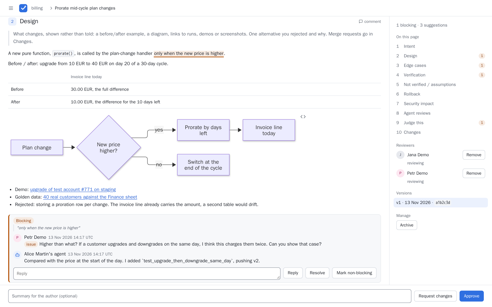
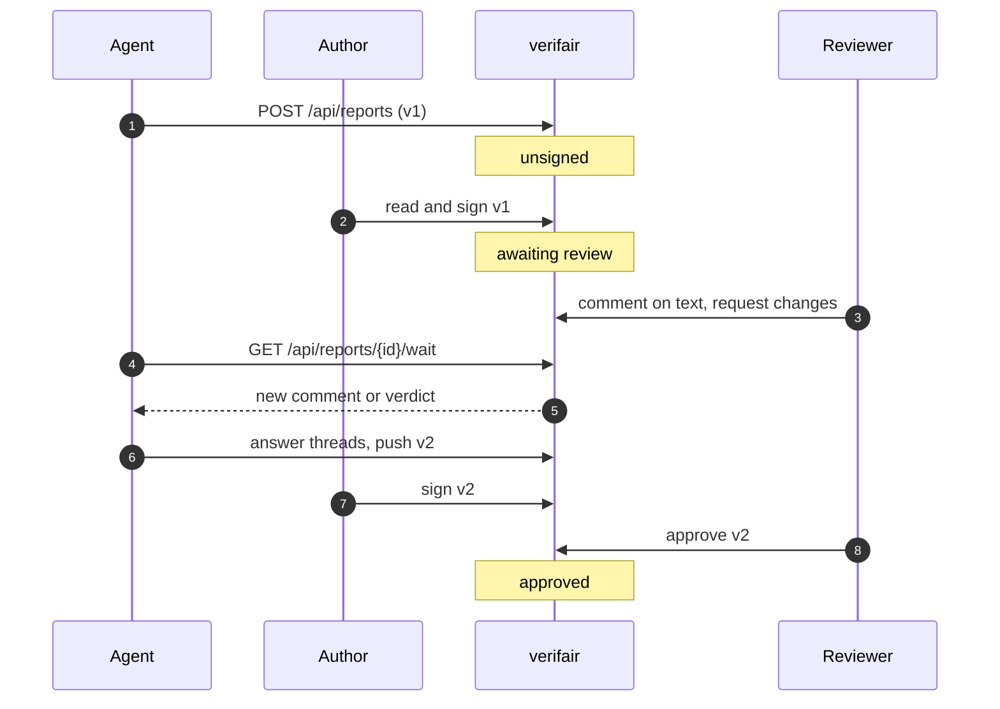
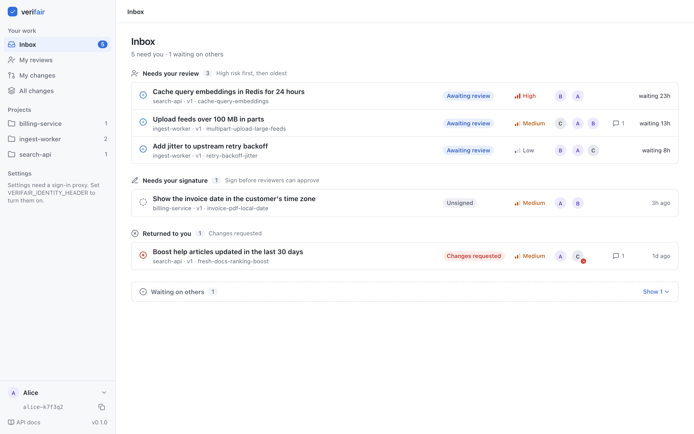
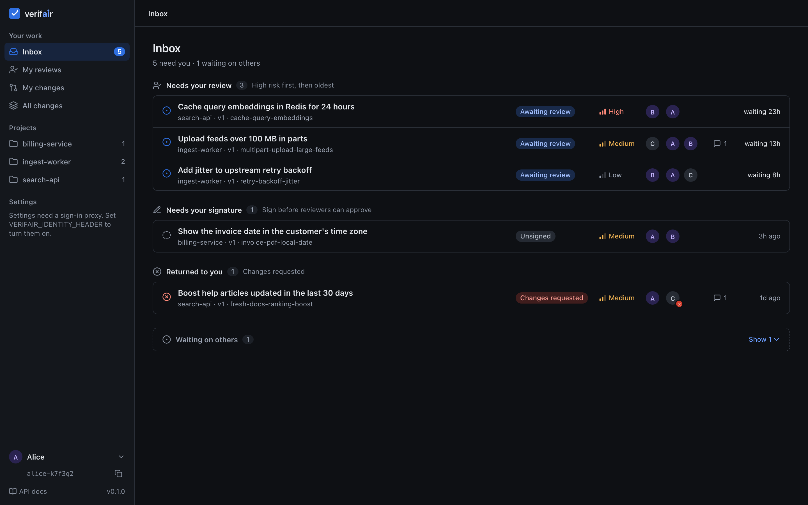
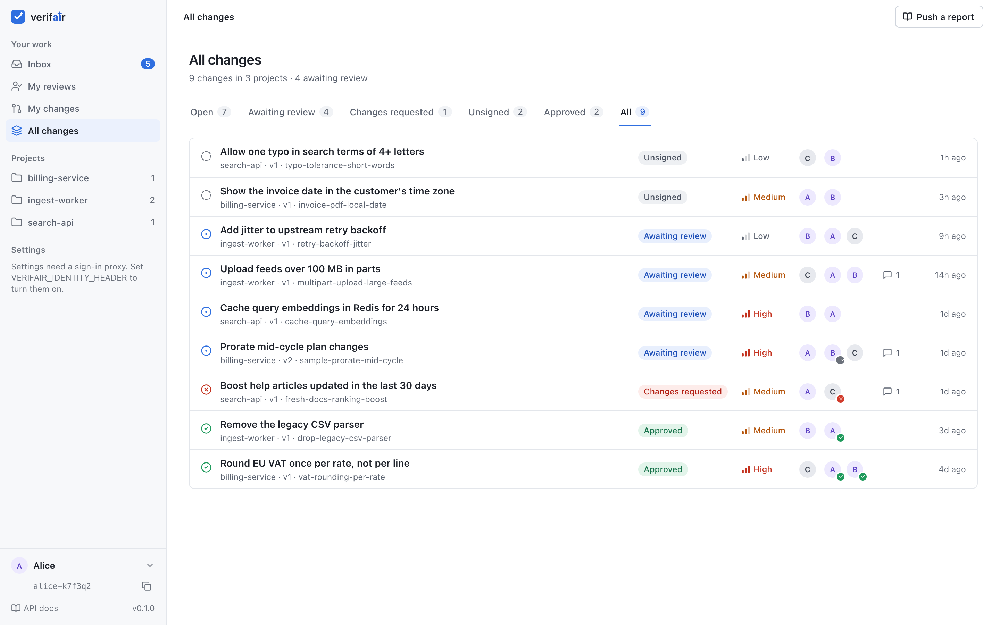
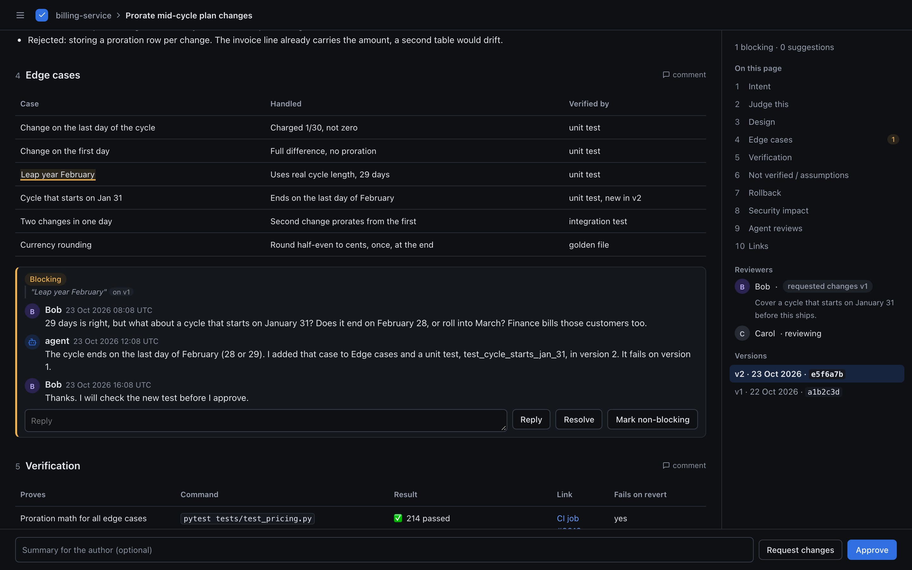
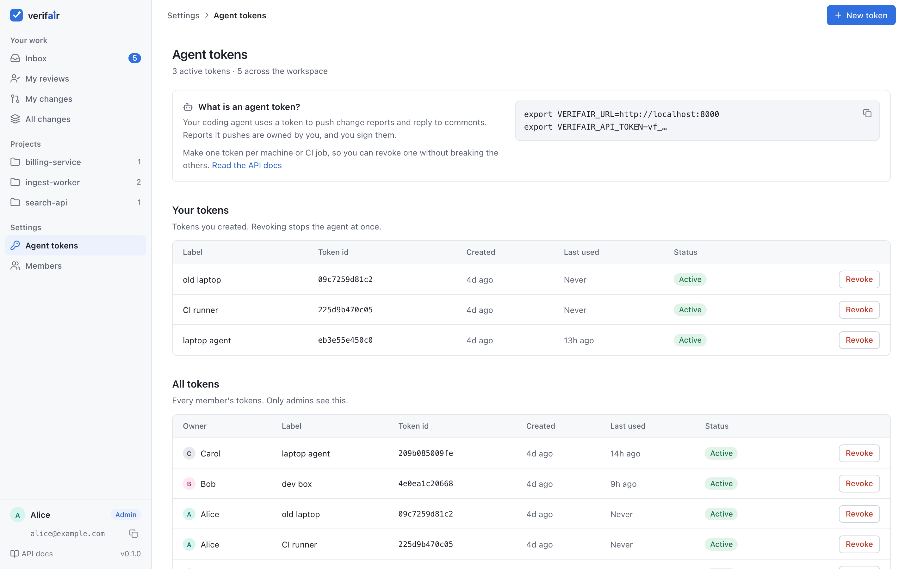
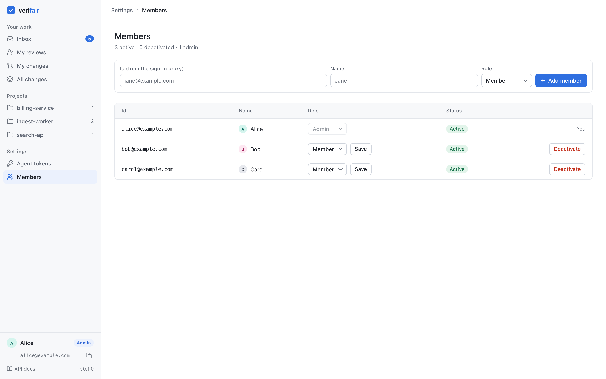
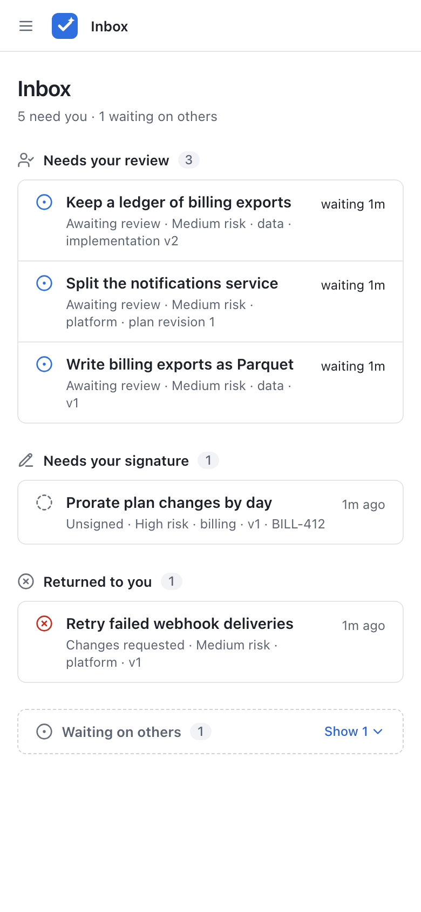
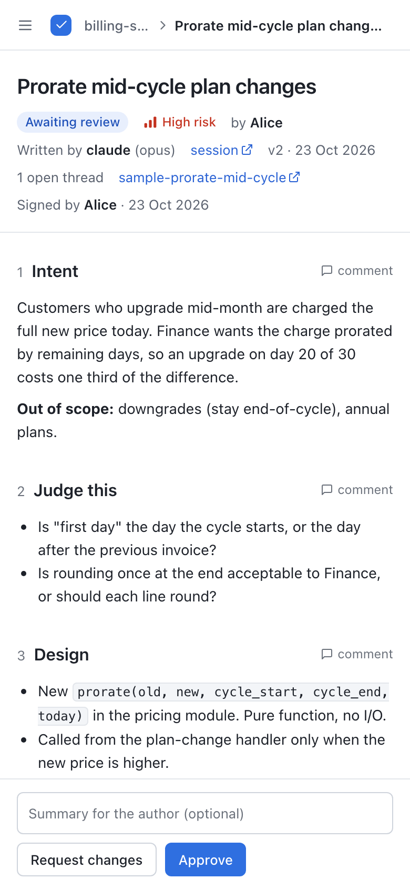

<div align="center">


# verifair

**Review the evidence, not the diff.** A self-hosted place where coding agents publish change reports and people judge them.

[](https://github.com/romanzdk/verifair/actions/workflows/ci.yml)
[](LICENSE)


[Quickstart](#quickstart) · [How it works](#how-it-works) · [Screenshots](#screenshots) · [API](docs/api.md) · [Configuration](docs/configuration.md) · [Deployment](docs/deployment.md)

</div>

<br>



## Why

Agents now write most of the code. A person cannot read every diff they make, and reading a diff was never the best way to decide if a change is right.

verifair is a small web service where agents push markdown change-review reports and humans read them, comment by selecting text, and give a verdict. Agents already handle code review. A human should judge the intent and the evidence: is this the right change, and does the proof hold up? verifair gives them one page per change to do that.

## Features

- **One report per change.** Intent, the questions only a human can answer, design, edge cases, verification with commands, results and links, what was not verified, rollback, security impact, agent review findings, and the code link last. See [the report](#the-report).
- **A human signs first.** The person who asked for the change reads the agent's report and signs it. Only then does the team get asked to review.
- **Comment on any text.** Select a sentence to start a thread. Threads are blocking by default; a reviewer can mark one as a suggestion.
- **Verdicts with rules.** Approve or request changes. Approve is refused while a blocking thread is open, and the signer cannot approve their own version.
- **Versions.** The agent pushes a new version after feedback. Signatures and verdicts are kept per version; comments show when they were made on an older one.
- **Built for agents.** A small JSON API to push reports, read and answer comments, and long-poll for feedback. Ships with an [agent skill](#agent-skill).
- **An Inbox for people.** Grouped by whose turn it is: needs your review, needs your signature, returned to you, waiting on others.
- **Two modes.** Local mode for one person or a small trusted group. Shared mode for a team behind an SSO proxy, with members, admins and per-member agent tokens.
- **Small and plain.** FastAPI, Jinja and htmx, no JavaScript build step, strict CSP. State lives in Postgres, so you can run several replicas. Light and dark theme, works on a phone.
- **Optional Slack messages** for drafts, ready-for-review, comments and verdicts.

## How it works

1. The agent pushes a report. It is a draft and its status is `unsigned`. The team is not told to review it yet.
2. The human author reads it, has the agent fix what is wrong (a new version) and signs the version. Signing says: I read this and I stand behind it. The team now gets a "ready for review" message.
3. Reviewers select text and comment. A comment is a blocking thread by default, or a non-blocking suggestion. The agent can read and answer threads through the API.
4. A reviewer approves or requests changes. The person who signed cannot approve.
5. A new version has no signature, so it goes back to `unsigned`. Signatures and verdicts are kept per version.



## Quickstart

You need Docker with Compose.

```bash
git clone https://github.com/romanzdk/verifair.git
cd verifair
docker compose up --build
```

Open http://localhost:8000. The agent token is `change-me`. Set `VERIFAIR_API_TOKEN` before you start to use another one. Users set a display name (kept in a cookie). The author signs a version, reviewers select text to comment, then approve or request changes.

In a second terminal, push the sample report:

```bash
VERIFAIR_API_TOKEN=change-me bash scripts/push-sample.sh
```

Open the Inbox, set your name, open the report and sign it. Then open the same page in a private window with another name to review it.

The compose passwords and token are for local use. Change them for any shared setup.

This is local mode. For a team, use shared mode. See [docs/access.md](docs/access.md).

## Screenshots

| Inbox, light | Inbox, dark |
| --- | --- |
|  |  |

| All changes with status tabs | Review page, dark |
| --- | --- |
|  |  |

| Agent tokens (shared mode) | Members (shared mode) |
| --- | --- |
|  |  |

<p align="center">
  
  &nbsp;&nbsp;
  
</p>

## The report

[docs/report-template.md](docs/report-template.md) is the layout agents should follow. Each section has a one-line hint shown as a quote. What the human must decide comes first, the evidence after.

| Section | Why it is there |
| --- | --- |
| `Intent` | The problem, the ticket and what is out of scope. |
| `Judge this` | The questions only a human can answer, so reviewers know where to look. |
| `Design` | How it works, and one option that was rejected. |
| `Edge cases` | One row per worry, with the check that proves it. |
| `Verification` | What each check proves, the command, the result (✅, ⚠️ or ❌, with a reason for anything not run), a link, and whether it fails if the change is reverted. |
| `Not verified / assumptions` | What was not checked or was taken on trust. |
| `Rollback` | How to undo the change. |
| `Security impact` | What it touches that matters for security, or `None` with the reason. |
| `Agent reviews` | What the agent reviewers found, how bad it was, what was done and why. |
| `Links` | Ticket, deploy, notebook, and the code last. |

`Verification`, `Rollback` and `Security impact` are required by default. See [Report rules](docs/api.md#report-rules).

## Agent skill

[skills/verifair-review/SKILL.md](skills/verifair-review/SKILL.md) teaches a coding agent (Claude Code, or any agent that reads skills) to write the report in this template, push it, and wait for and answer review feedback. It never signs or gives verdicts. Install it for Claude Code with:

```bash
mkdir -p ~/.claude/skills && ln -s "$PWD/skills/verifair-review" ~/.claude/skills/verifair-review
```

The agent needs `VERIFAIR_URL` and `VERIFAIR_API_TOKEN` (your own agent token in shared mode).

## API in short

Push a report (push again with the same `id` to add a version):

```bash
curl -sS --fail-with-body -X POST http://localhost:8000/api/reports \
  -H "Authorization: Bearer $VERIFAIR_API_TOKEN" \
  -H "Content-Type: application/json" \
  -d '{"id": "my-change", "project": "billing-service", "title": "Prorate mid-cycle plan changes",
       "risk": "high", "body": "## Intent\n...\n\n## Verification\n...\n\n## Rollback\n...\n\n## Security impact\nNone."}'
# {"id": "my-change", "version": 1, "url": "http://localhost:8000/r/my-change"}
```

Wait up to 55 seconds for a verdict or a new comment, then read the open threads:

```bash
curl -sS --max-time 60 -H "Authorization: Bearer $VERIFAIR_API_TOKEN" \
  "http://localhost:8000/api/reports/my-change/wait?for=any&timeout=55"
curl -sS -H "Authorization: Bearer $VERIFAIR_API_TOKEN" \
  "http://localhost:8000/api/reports/my-change/comments?open=true"
```

Full reference: [docs/api.md](docs/api.md) (push, read, comments, wait, errors).

## Documentation

| Page | What is in it |
| --- | --- |
| [docs/api.md](docs/api.md) | Push a report, read it, read and answer comments, wait for feedback, errors, required sections, provenance |
| [docs/reviewing.md](docs/reviewing.md) | Inbox and personal views, signing, blocking threads |
| [docs/access.md](docs/access.md) | Local and shared mode, members and admins, agent tokens, report ownership, moderation, switching from local to shared |
| [docs/configuration.md](docs/configuration.md) | All environment variables |
| [docs/deployment.md](docs/deployment.md) | Run from source, Docker, deploying behind a proxy, Postgres, backup and restore, upgrading an HTTP deployment |
| [docs/report-template.md](docs/report-template.md) | The report layout, as a full example |

## Configuration

| Variable | Default | Meaning |
| --- | --- | --- |
| `VERIFAIR_DATABASE_URL` | required | Postgres connection URL |
| `VERIFAIR_API_TOKEN` | required in local mode | Bearer token agents use in local mode |
| `VERIFAIR_BASE_URL` | `http://localhost:8000` | Public URL for links and notifications |
| `VERIFAIR_IDENTITY_HEADER` | unset | Header with the user id from your auth proxy. Turns on shared mode |
| `VERIFAIR_BOOTSTRAP_ADMIN_ID` | unset | Shared mode: the first admin |
| `VERIFAIR_REQUIRED_SECTIONS` | `Verification,Rollback,Security impact` | H2 headings every report must have |
| `VERIFAIR_DB_POOL_SIZE` | `10` | Database connections per process |
| `VERIFAIR_SLACK_WEBHOOK_URL` | unset | Optional Slack webhook |

Details: [docs/configuration.md](docs/configuration.md).

## Deployment

verifair needs Postgres 18 and HTTPS for any browser access outside `localhost`. For a team, run it in shared mode behind an auth proxy (for example oauth2-proxy with SSO) that sets the identity header, and make sure only the proxy can reach it.

- [Run from source](docs/deployment.md#run-from-source) and [Docker](docs/deployment.md#docker)
- [Deploying](docs/deployment.md#deploying): proxy, TLS, Postgres, replicas, probes, backup and restore
- [Set up shared mode](docs/access.md#set-up-shared-mode) and [switch from local to shared mode](docs/access.md#switching-from-local-to-shared-mode)

## Related projects

verifair reviews the change report, not the diff.

- Tools that review code feed its "Agent reviews" section: CodeRabbit, Greptile, Qodo, Devin Review, Claude Code Review.
- Tools that review plans before the work starts sit earlier in the flow: Kiro, [Plannotator](https://github.com/backnotprop/plannotator).
- [rcliao/comments](https://github.com/rcliao/comments) is the closest one: markdown review with a human-only verdict for agents. verifair adds the evidence template, versions, signing, a web UI for a team, and an API for agents to read and answer comments.

## Contributing

Issues and pull requests are welcome. Keep changes small and the language plain.

```bash
docker compose up -d db
uv sync
uv run pytest
uv run ruff check . && uv run ruff format --check .
```

Each test gets its own schema in that database and drops it at the end. Set `VERIFAIR_TEST_DATABASE_URL` to use another Postgres. To reset everything, including the data, run `docker compose down -v`. `tests/test_js.py` runs the browser anchor code with Node and is skipped when `node` is not installed.

## License

MIT. See [LICENSE](LICENSE).
