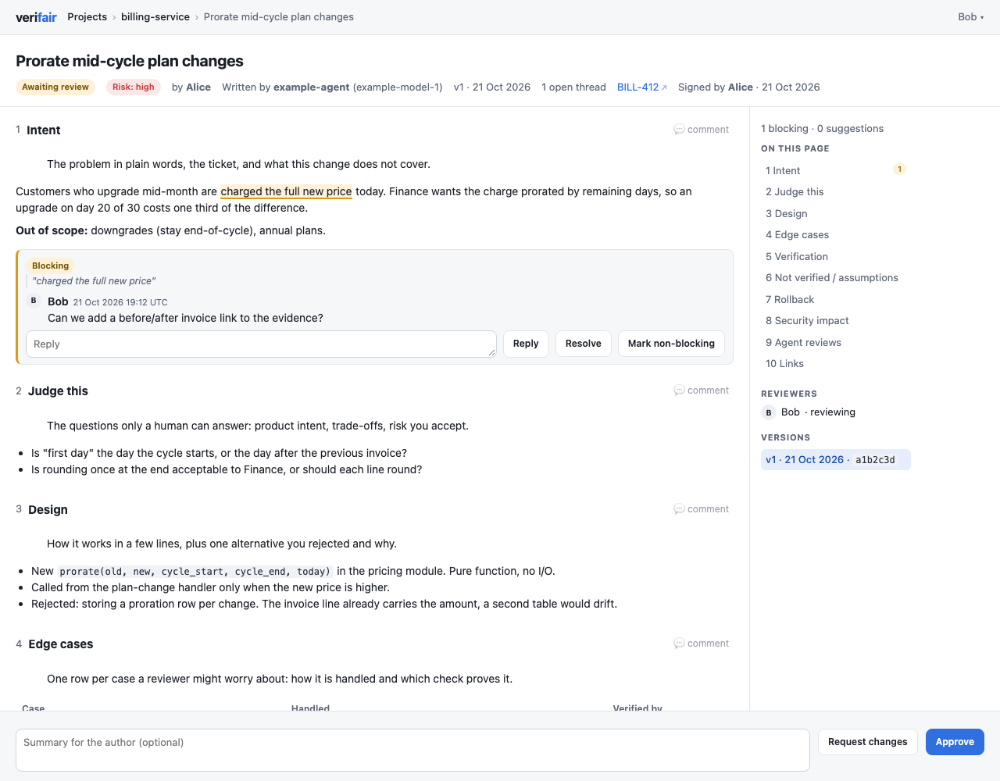

# verifair

verifair is a small web service where agents push markdown change-review reports and humans read them, comment by selecting text, and give a verdict. Agents already handle code review. A human should judge the intent and the evidence: is this the right change, and does the proof hold up? verifair gives them one page per change to do that.



## How it works

1. The agent pushes a report. It is a draft and its status is `unsigned`. The team is not told to review it yet.
2. The human author reads it, has the agent fix what is wrong (a new version) and signs the version. Signing says: I read this and I stand behind it. The team now gets a "ready for review" message.
3. Reviewers select text and comment. A comment is a blocking thread by default, or a non-blocking suggestion. The agent can read and answer threads through the API.
4. A reviewer approves or requests changes. The person who signed cannot approve.
5. A new version has no signature, so it goes back to `unsigned`. Signatures and verdicts are kept per version.

## Run it

```bash
uv sync
export VERIFAIR_API_TOKEN=change-me
uv run uvicorn verifair.asgi:app
```

Open http://localhost:8000. Users set a display name (kept in a cookie). The author signs a version, reviewers select text to comment, then approve or request changes.

This is local mode. For a team, use shared mode. See [Roles and access](#roles-and-access).

## Personal views

Everyone sees all projects and changes by default. The landing pages also offer **My changes** (reports you own, including unsigned drafts) and **My reviews** (reports where your review was requested, including completed reviews). These scopes combine with project status filters. Project cards, previews and counts use the selected scope, and links between the landing pages preserve it.

Open **Your identity** on either landing page to copy the ID to give your agent. Set `author_id` to the owner's ID and `reviewers` to the requested reviewers' IDs when publishing. In shared mode the agent token sets the owner, so `author_id` can be left out. Display names do not determine ownership. Review requests help people find work; anyone with access can still read and review a report, and the existing signature and approval rules apply.

Local identities belong to a browser. With the auth proxy described under Deploying, the trusted identity header supplies the same ID across devices. Existing signed reports get their owner from their latest recorded signature when the database is upgraded. In local mode, signing a report without an owner records the signer as the owner, and **My changes** also lists unowned reports whose `author` equals your identity. In shared mode only `author_id` counts, and a report without an owner is frozen (see [Report ownership](#report-ownership)).

## Push a report

```bash
curl -sS --fail-with-body -X POST http://localhost:8000/api/reports \
  -H "Authorization: Bearer $VERIFAIR_API_TOKEN" \
  -H "Content-Type: application/json" \
  -d '{
    "id": "my-change",
    "project": "billing-service",
    "title": "Prorate mid-cycle plan changes",
    "risk": "high",
    "body": "## Intent\nCharge upgrades by remaining days.\n\n## Verification\nUnit tests pass.\n\n## Rollback\nRevert the merge request.\n\n## Security impact\nNone.",
    "ticket_url": "https://example.com/tickets/BILL-412",
    "links": [{"label": "Merge request", "url": "https://example.com/code/merge_requests/231"}],
    "author": "Alice",
    "author_id": "alice@example.com",
    "reviewers": ["bob@example.com"],
    "agent": "claude",
    "model": "opus",
    "commit": "a1b2c3d"
  }'
```

Response:

```json
{"id": "my-change", "version": 1, "url": "http://localhost:8000/r/my-change"}
```

The commands below use the report `id` as `$ID`. In shared mode, use your own agent token instead of `$VERIFAIR_API_TOKEN`.

- `id` is optional on the first push. Without it, verifair makes one from the title and returns it.
- To add a new version, push again with the same `id`. Without `id`, every push makes a new report. Comments stay on the version they were made on; the API marks them `stale` when a newer version exists and `found` when the quoted text can be located in the current version, including after a section rename or move.
- Required: `project`, `title` (1 to 200 characters), `risk` (`low`, `medium` or `high`) and `body` (markdown).
- `project` and `id` must match `^[A-Za-z0-9][A-Za-z0-9._-]{0,99}$`: letters, digits, `.`, `_` and `-`, starting with a letter or digit, up to 100 characters.
- `ticket_url`, `session_url` and `links[].url` must start with `http://` or `https://`.
- Optional `author` (up to 60 characters): the human author's display name. Defaults to `agent`. Use `author_id` to link ownership to a stable identity. In shared mode `author` is ignored and the report shows the token owner's name.
- Optional `author_id`: the owner's stable identity, separate from the display name in `author`. Optional `reviewers`: up to 50 stable identities to request reviews from. Each ID must be 1–256 characters and cannot be `agent`. In local mode it must match the user's identity exactly; in shared mode verifair turns `author_id` and `reviewers` into lower case first. Duplicate reviewers are stored once.
- On later versions, omitted `author`, `author_id` and `reviewers` retain their previous values. In local mode a supplied `author_id` transfers ownership; a supplied reviewer list replaces the requests, and `reviewers: []` clears them. `null` for `author_id` or `reviewers` also leaves the existing value unchanged. Requests belong to the change and survive signing, verdicts and new versions.
- Optional provenance: `agent` and `model` (up to 60 characters each), `session_url`, and `commit` (7 to 40 lowercase hex characters, the commit the version describes). The report keeps the latest `agent`, `model` and `session_url`; `commit` is stored per version.
- The body must contain every section in `VERIFAIR_REQUIRED_SECTIONS` as a top-level H2 heading, spelled exactly (case matters). Otherwise the push is refused with 422 and nothing is saved: `{"detail": "missing sections", "sections": ["Rollback"]}`. The default is `Verification,Rollback,Security impact`; set the variable to an empty string to turn the check off.
- Unknown JSON keys are rejected with 422.
- In shared mode the token owner owns the report. `author_id` can be left out; if sent, it must be the token owner, or the push gets 403 `"author_id must be the token owner."`. A push to an `id` that belongs to another member's report gets 403 `"This report belongs to another member."`, also when the token owner is an admin. A push to an `id` whose report has no owner gets 403 `"This report has no owner. Push it again with an agent token under a new id."`. Every requested reviewer must be an active member, or the push gets 422 `"Reviewer {id} is not an active member."`.

A push sends a "draft" message to Slack (if configured). The "ready for review" message is sent when the version is signed.

Report markdown: raw HTML is shown as text, not rendered, and `javascript:` links are dropped. Use plain markdown only.

`scripts/push-sample.sh` pushes the report template as a draft example with the fixed id `sample-prorate-mid-cycle`, so running it again adds a new version. It sends to `http://localhost:8000` unless you set `VERIFAIR_URL`. For any URL that is not localhost it also needs `VERIFAIR_ALLOW_REMOTE=1`:

```bash
VERIFAIR_API_TOKEN=change-me bash scripts/push-sample.sh
VERIFAIR_API_TOKEN=change-me VERIFAIR_URL=https://verifair.example.com VERIFAIR_ALLOW_REMOTE=1 bash scripts/push-sample.sh
```

## Read a report

`GET /api/reports/$ID` returns the report metadata, status, versions and verdicts. It does not return the markdown body.

```json
{
  "id": "my-change",
  "project": "billing-service",
  "title": "Prorate mid-cycle plan changes",
  "risk": "high",
  "ticket_url": "https://example.com/tickets/BILL-412",
  "links": [{"label": "Merge request", "url": "https://example.com/code/merge_requests/231"}],
  "author": "Alice",
  "author_id": "alice@example.com",
  "reviewers": ["bob@example.com"],
  "agent": "claude",
  "model": "opus",
  "session_url": "https://example.com/sessions/42",
  "signed_by": "Alice",
  "signed_at": "2026-10-21T09:30:00+00:00",
  "status": "changes_requested",
  "current_version": 2,
  "versions": [
    {"version": 1, "created_at": "2026-10-21T09:00:12+00:00", "commit": "a1b2c3d"},
    {"version": 2, "created_at": "2026-10-21T11:30:40+00:00", "commit": null}
  ],
  "verdicts": [
    {"reviewer": "Alice", "reviewer_id": "4f0c1a", "verdict": "approve", "version": 1, "current": false, "summary": "", "created_at": "2026-10-21T10:02:00+00:00"},
    {"reviewer": "Bob", "reviewer_id": "9be2d7", "verdict": "request_changes", "version": 2, "current": true, "summary": "Add the leap year case.", "created_at": "2026-10-21T12:15:09+00:00"}
  ]
}
```

- `status` is `unsigned`, `awaiting_review`, `changes_requested` or `approved`. It is `unsigned` until someone signs `current_version`; after that it only counts verdicts on `current_version` from people other than its signer. Earlier verdicts by the signer remain in the history, including after a database upgrade.
- `signed_by` and `signed_at` describe the signature on `current_version`, or are `null`. `agent`, `model` and `session_url` are `null` when the push did not send them.
- `verdict` is `approve` or `request_changes`. `current` is true when the verdict was given on `current_version`.

## Read and answer comments

```bash
curl -sS --fail-with-body -H "Authorization: Bearer $VERIFAIR_API_TOKEN" \
  "http://localhost:8000/api/reports/$ID/comments?open=true"
```

Response (`open=true` leaves out resolved threads):

```json
{
  "threads": [
    {
      "id": 1,
      "version": 1,
      "parent_id": null,
      "section": "Edge cases",
      "quote": "first day of the cycle",
      "prefix": null,
      "suffix": null,
      "author": "Alice",
      "author_id": "4f0c1a",
      "author_type": "human",
      "body": "Which first day?",
      "created_at": "2026-10-21T09:14:03+00:00",
      "blocking": true,
      "resolved": false,
      "stale": true,
      "found": true,
      "moved": false,
      "match_start": 0,
      "replies": [
        {
          "id": 2, "version": 1, "parent_id": 1, "section": "Edge cases", "quote": "first day of the cycle",
          "author": "agent", "author_id": "agent", "author_type": "agent",
          "body": "Cycle start day, inclusive.", "created_at": "2026-10-21T09:20:41+00:00",
          "blocking": true, "resolved": false, "stale": true, "found": true,
          "prefix": null, "suffix": null, "moved": false, "match_start": 0
        }
      ]
    }
  ]
}
```

- `stale` is true when the comment was made on an older version.
- `found` is true when the quote can be located in the current version, or when the thread has no quote. Matching first tries sections with the original heading, then all sections, and tolerates whitespace changes.
- `moved` is true when the quote was found in another section. `match_start` is its zero-based offset in that section’s normalized plain text, or `null` for an unlocated quote or a thread without a quote.
- `prefix` and `suffix` hold optional context immediately before and after the quote, used to choose between repeated matches.
- Replies carry the same anchor fields, `stale`, `found`, `moved` and `match_start` as their thread.
- `author_type` is `agent` or `human`.

Post a comment with `POST /api/reports/$ID/comments` and `{body, author?, parent_id?, section?, quote?, prefix?, suffix?, blocking?}`. The response is 201 with one comment (same fields as above, without `stale`, `found`, `moved`, `match_start` and `replies`).

```bash
curl -sS --fail-with-body -X POST "http://localhost:8000/api/reports/$ID/comments" \
  -H "Authorization: Bearer $VERIFAIR_API_TOKEN" \
  -H "Content-Type: application/json" \
  -d '{"body": "Cycle start day, inclusive.", "parent_id": 1}'
```

- With `parent_id` it is a reply. In local mode a reply to a resolved thread opens it again. In shared mode an agent reply opens it again only when the agent started the thread; a reply to a thread a person started leaves it resolved. A reply inherits its anchor from the thread, so any non-null `section`, `quote`, `prefix` or `suffix` with `parent_id` is rejected with 422 `"replies cannot set section, quote, prefix or suffix"`.
- Without `parent_id` it starts a new thread. `section` must be an H2 heading of the current version, exactly as written, for example `"section": "Edge cases"`. Text before the first `##` is the section `Intro`; a report with no `##` at all is one section called `Report`. `quote` points at a piece of text in that section, so `quote` without `section` is rejected with 422 `"quote requires section"`.
- `section` and `quote` are limited to 2,000 characters each; `prefix` and `suffix` to 64 each. A quote repeated within the named section without nonempty context is rejected with 422 `"ambiguous quote"`. Add `prefix` or `suffix` to disambiguate it.
- Without `section` the thread is a general comment on the whole report.
- `blocking` defaults to `true`. Send `false` for a nit that should not hold up approval. Replies always take `blocking` from their thread.
- In shared mode an agent token can only comment on its owner's reports. Other reports return 403 `"This report belongs to another member."`, and reports with no owner return 403 `"This report has no owner. Push it again with an agent token under a new id."`.

To close a thread: `POST /api/reports/$ID/comments/{comment_id}/resolve`. `comment_id` can be the first comment or any reply; the whole thread is resolved. The response is `{"resolved": true}`. Calling it again does nothing. Reviewers can reopen a resolved thread in the web UI.

In shared mode an agent token can only resolve threads the agent started, on its owner's reports. Any other thread returns 403 `"Only the person who started this thread or an admin can do that."`.

## Wait for feedback

`GET /api/reports/$ID/wait` waits for a verdict or a new root comment on the latest version. It checks the database every 0.5 seconds and returns one event. Replies, signatures, resolutions and version pushes are not events. Each check uses the latest version, so feedback on an older version is ignored even if it arrives during the wait.

```bash
curl -sS --fail-with-body --max-time 60 -G \
  -H "Authorization: Bearer $VERIFAIR_API_TOKEN" \
  --data-urlencode "for=verdict" \
  --data-urlencode "since=2026-10-21T12:15:09+00:00" \
  --data-urlencode "timeout=55" \
  "http://localhost:8000/api/reports/$ID/wait"
```

- `for` is `verdict`, `comment` or `any` (the default).
- `timeout` is seconds, greater than zero and at most 55; the default is 55. Fractions are accepted.
- `since` is an ISO datetime. Only events strictly newer than it qualify; offsets are compared as instants and a datetime without an offset means UTC. Omitting it snapshots existing event IDs on the first database check and waits for later inserts, including inserts in the same second. Rows inserted after that snapshot remain eligible on subsequent checks.
- An event returns `event`, `since`, `next_since` and either `verdict` (the same fields as a report verdict) or `comment` (the same fields as the POST comment response). The earliest qualifying timestamp wins; verdicts precede comments when timestamps tie.
- A timeout returns `{"event": "timeout", "since": "...", "next_since": "..."}` with the same timestamp in both fields. `since` is the supplied instant normalized to UTC, or the UTC request start time when omitted. On an event, `next_since` is the event’s `created_at`.

This endpoint signals feedback; it does not provide a lossless event stream. Stored event timestamps have second precision, so reusing `next_since` excludes other events from that same second. Read the report and comment endpoints after a signal to collect all feedback.

## Errors

| Status | `detail` |
| --- | --- |
| 401 | `"invalid token"` |
| 403 | shared mode only: `"This report belongs to another member."`, `"author_id must be the token owner."` or `"Only the person who started this thread or an admin can do that."` |
| 404 | `"report not found"`, `"parent not found"` or `"comment not found"` |
| 409 | `"id belongs to another project"` |
| 422 | a list of field errors (pydantic style), `"replies cannot set section, quote, prefix or suffix"`, `"quote requires section"`, `"ambiguous quote"`, `"unknown section"`, `"missing sections"` or, in shared mode, `"Reviewer {id} is not an active member."` |

An unknown section also lists the valid headings: `{"detail": "unknown section", "sections": ["Intent", "Edge cases"]}`. Missing sections lists the required headings the body lacks, in the configured order.

## Configuration

| Variable | Default | Meaning |
| --- | --- | --- |
| `VERIFAIR_API_TOKEN` | required in local mode | Bearer token agents use for `/api` in local mode. Not accepted in shared mode (startup logs a warning if it is set) |
| `VERIFAIR_DB_PATH` | `./verifair.db` | SQLite file |
| `VERIFAIR_BASE_URL` | `http://localhost:8000` | Used for links in API responses and notifications |
| `VERIFAIR_REQUIRED_SECTIONS` | `Verification,Rollback,Security impact` | Comma-separated H2 headings every pushed body must have; empty turns the check off |
| `VERIFAIR_IDENTITY_HEADER` | unset | Name of a request header that carries the user identity. Setting it turns on shared mode (see Roles and access) |
| `VERIFAIR_BOOTSTRAP_ADMIN_ID` | unset | Shared mode: id of the first admin, created when the database has no members |
| `VERIFAIR_SLACK_WEBHOOK_URL` | unset | Optional Slack webhook for draft reports, ready-for-review notifications, comments and verdicts |

## Report template

[docs/report-template.md](docs/report-template.md) is the layout agents should follow. Each section has a one-line hint shown as a quote. What the human must decide comes first, the evidence after.

| Section | Why it is there |
| --- | --- |
| `Intent` | The problem, the ticket and what is out of scope. |
| `Judge this` | The questions only a human can answer, so reviewers know where to look. |
| `Design` | How it works, and one option that was rejected. |
| `Edge cases` | One row per worry, with the check that proves it. |
| `Verification` | What each check proves, the command, the result (✅, ⚠️ or ❌, with a reason for anything not run), a link, and whether it fails if the change is reverted. |
| `Not verified / assumptions` | What was not checked or was taken on trust. |
| `Rollback` | How to undo the change. |
| `Security impact` | What it touches that matters for security, or `None` with the reason. |
| `Agent reviews` | What the agent reviewers found, how bad it was, what was done and why. |
| `Links` | Ticket, deploy, notebook, and the code last. |

### Required sections

A push is refused with 422 if the body lacks a required top-level H2 heading. Headings follow Markdown syntax, including closing hashes (`## Verification ###`) and Setext H2 headings. Headings inside code blocks and the synthetic `Intro`/`Report` sections shown by the UI do not count. The list comes from `VERIFAIR_REQUIRED_SECTIONS`. The default is `Verification,Rollback,Security impact`. Set it to an empty string to turn the check off.

### Provenance

`agent`, `model`, `session_url` and `commit` tell the reader who wrote the report and what it describes. The page shows who wrote it and the commit next to each version. Agents should also add a trailer to their own commits:

```
Assisted-by: AGENT:MODEL
```

For example `Assisted-by: claude:opus`. Agents do not add `Signed-off-by`. Only a human does that.

## Signing

- A version must be signed before anyone can approve or request changes on it. Until then the status is `unsigned`.
- The first signature on a version is kept. Signing again does nothing.
- Without `VERIFAIR_IDENTITY_HEADER`, anyone who has set a name can sign. The name is only a cookie, so this is a convenience, not a control.
- With `VERIFAIR_IDENTITY_HEADER`, only the owner can sign: `author_id` must equal the header value (for example the email). A report with no `author_id` cannot be signed: `This report has no owner. Push it again with an agent token under a new id.`
- The person who signed a version cannot approve it or request changes on it. Someone else has to.
- Only with the identity header behind an auth proxy is signing a real control. See Deploying.

## Blocking threads

- A new thread is blocking by default. A reviewer can tick "Non-blocking (suggestion)" when writing it, and switch a thread between blocking and non-blocking later. In shared mode only some people can do that; see [Moderation](#moderation).
- Approve is refused while any blocking thread is open. Resolve the thread or mark it non-blocking first.
- Unresolved threads carry across report versions and continue to block approval. `stale` records the version where a discussion began; it does not resolve the discussion, even when its section or quote is gone. Close obsolete concerns explicitly or mark them non-blocking.
- Request changes needs a summary, or an open blocking thread of your own.
- The sidebar counts open blocking threads and suggestions.

## Roles and access

verifair has two modes. `VERIFAIR_IDENTITY_HEADER` switches between them.

- **Local mode** (the header is not set): no sign-in. People set a name, kept in a cookie. Agents share one `VERIFAIR_API_TOKEN`. Anyone can resolve any thread. Use it on your own machine or in a small trusted group. `/access` only shows a note.
- **Shared mode** (the header is set): an auth proxy signs people in and verifair checks that they are members. Each agent uses a token owned by one member. This is the mode for a team.

### Set up shared mode

1. Put verifair behind an auth proxy that signs users in, for example with SSO.
2. The proxy must set the identity header on every request. It must strip any value the client sent and write its own. Otherwise anyone can pose as anyone.
3. Make verifair reachable only through the proxy. Anyone who can reach it directly can send any header.
4. Set `VERIFAIR_IDENTITY_HEADER` to the header name, for example `X-Forwarded-Email`.
5. Set `VERIFAIR_BOOTSTRAP_ADMIN_ID` to your own id as the proxy sends it, for example `jane@example.com`. Case does not matter. On a database with no members, startup makes this id the first admin. Once members exist, it adds no one.
6. `VERIFAIR_API_TOKEN` is not needed. If it is set, shared mode refuses it and startup logs a warning.

```bash
export VERIFAIR_IDENTITY_HEADER=X-Forwarded-Email
export VERIFAIR_BOOTSTRAP_ADMIN_ID=jane@example.com
uv run uvicorn verifair.asgi:app
```

Startup fails when the database has no members and `VERIFAIR_BOOTSTRAP_ADMIN_ID` is not set. It also fails when the id is not a plain id (no spaces, `/` or `\`, and not `agent`). Startup logs `bootstrap admin created id=...` or `bootstrap skipped: members exist`.

Once a database has members, it stays in shared mode. Starting it without `VERIFAIR_IDENTITY_HEADER` fails with `This database has members. Set VERIFAIR_IDENTITY_HEADER to run in shared mode.` This stops a config mistake from opening the workspace to everyone.

A request without the header, or with the header sent more than once, gets 401. A signed-in person who was never added gets 403 with a note to ask an admin to add their id. A deactivated member gets 403 `Your access to this workspace was turned off. Ask an admin to reactivate {id}.` Each refusal is logged at INFO as `membership denied reason=... path=...`, where the reason is `missing-header`, `duplicate-header`, `not-member` or `inactive`. `/healthz` and `/static/` stay public. `/api/` uses tokens. Every other page, including `/docs` and `/openapi.json`, needs membership.

### What members and admins can do

| Action | Member | Admin | Agent token |
| --- | --- | --- | --- |
| Read all projects, reports and threads | Yes | Yes | Yes |
| Push a report or a new version | Through their own agent token | Same as a member | The owner's reports only |
| Comment, reply, reopen a thread | Yes | Yes | Comment and reply on the owner's reports |
| Sign a version | Own reports | Own reports | No |
| Approve or request changes | Reports someone else signed | Same as a member | No |
| Resolve a thread or change its blocking flag | Threads they started, and agent threads on their own reports | Any thread | Resolve agent threads on the owner's reports |
| Create and revoke agent tokens | Own tokens | Own tokens, and revoke anyone's | No |
| Add members, change roles, deactivate | No | Yes | No |

### Members and roles

Admins manage members on the **Access** page (`/access`, linked next to **Your identity** on the landing pages). To add a member, enter their id as the proxy sends it, a display name, and a role: `admin` or `member`. Ids are matched without regard to case: verifair stores them in lower case and turns the header value into lower case too, so `Jane@Example.com` and `jane@example.com` are the same member. The members table changes roles and deactivates or reactivates people. Members are never deleted, so their history stays.

A deactivated member is refused on their next request, and all their tokens are revoked. Reactivating them does not bring old tokens back.

There must always be at least one active admin. verifair refuses to demote or deactivate the last one: `There must be at least one active admin.`

Admin and token actions are written to the app log as `access action=... actor=... target=...`. The token secret is never logged.

### Agent tokens

Every member creates their own agent tokens on `/access`. A token looks like `vf_<id>.<secret>`. It is shown once, right after you create it. Copy it then; verifair keeps only a hash. Send it as `Authorization: Bearer vf_...`.

- The `/access` page lists your tokens. Revoke a token there when you no longer need it. Admins can revoke anyone's token.
- Deactivating a member revokes their tokens.
- A token acts for its owner, but never with admin power, even when the owner is an admin. It cannot push to or comment on another member's report, and it cannot resolve threads that a person started.
- The shared `VERIFAIR_API_TOKEN` is refused in shared mode.

### Report ownership

The token owner owns every report the token pushes. Report ids are chosen by the client. If an id is already used by another member's report, the push gets 403 `This report belongs to another member.` Pick a different id, or leave `id` out and verifair makes a new one. Ownership cannot be transferred.

A report with no owner (an old report pushed with the shared token and never signed) is frozen in shared mode. Nobody can sign it, push a new version to it, or comment on it with an agent token. People can still read it and comment in the browser. To go on, push it again with an agent token under a new id.

### Moderation

In shared mode, anyone can reply to a thread or reopen it with the **Reopen** button. Only these people can resolve a thread or change its blocking flag:

- the person who started the thread,
- an admin,
- the report owner, when the agent started the thread.

A reply to a resolved thread opens it again only when the person replying could resolve it. The same rule holds for agent tokens: the owner's agent reopens a thread by replying only when the agent started it. So an agent that answers "fixed" on a reviewer's resolved thread does not open it again, but the reviewer's own reply does. In local mode every reply opens the thread again.

The buttons are hidden for everyone else, and a direct request gets 403 `Only the person who started this thread or an admin can do that.` A resolved thread shows who resolved it.

In local mode, anyone can resolve any thread.

### Moving an existing deployment to shared mode

A deployment that already sets `VERIFAIR_IDENTITY_HEADER` runs in shared mode after the upgrade. Set `VERIFAIR_BOOTSTRAP_ADMIN_ID` before you upgrade, or startup fails. Then add the members on `/access` and give each agent a member token. The old shared token stops working. Existing reports keep their `author_id`. A member can push new versions only to reports whose `author_id` is their id.

### Not built yet

- An audit log in the app.
- Token scopes and token expiry.
- Ownership transfer.
- Admin overrides, such as resolving with a recorded reason.
- Moving local-mode identities to member ids.

## Docker

```bash
docker build -t verifair .
docker run --rm -e VERIFAIR_API_TOKEN=change-me -p 127.0.0.1:8000:8000 -v verifair-data:/data verifair
```

The database lives in `/data/verifair.db`, so keep `/data` on a volume. For bind mounts or Kubernetes PVCs, `/data` must be writable by uid 10001 (`chown 10001 <dir>` or `fsGroup: 10001`).

## Deploying

- In local mode the web UI has no login. Anyone who can open it can comment and give verdicts. Run it on a private network or behind an auth proxy (SSO, basic auth). For a team, use shared mode (see Roles and access). The Docker example above only listens on `127.0.0.1`.
- HTTPS is required for browser access outside loopback, including private-network hostnames. Local development may use HTTP on `localhost`, `127.0.0.1` or `[::1]`. Put a TLS reverse proxy in front of the loopback listener for shared deployments. Ordinary HTTP hostnames can load pages but browser writes return 403 because browsers omit the required `Sec-Fetch-Site` header on those origins.
- To identify users from an auth proxy, set `VERIFAIR_IDENTITY_HEADER` to the header the proxy adds, for example `X-Forwarded-Email` with oauth2-proxy. This turns on shared mode. The header value becomes the user id; the display name comes from the member list. The name prompt goes away, and signing and approvals are tied to that identity. The proxy must strip this header from client requests, or anyone can pose as anyone. Requests without the header get 401, but keep the app reachable only through the proxy.
- Set `VERIFAIR_BASE_URL` to the public HTTPS URL, for example `https://verifair.example.com`. It is used in notification links and in the push response, and enables secure cookies. Keep the browser on this origin and have the reverse proxy preserve `Sec-Fetch-Site`.
- Serve it at the root of a domain. Sub-paths (like `/verifair/`) are not supported.
- `/data` must be a volume on local disk. SQLite runs in WAL mode and does not work well on network file systems.
- Back up with `sqlite3 /data/verifair.db ".backup /backup/verifair.db"`, not `cp`, which can copy a half-written file.
- Run one replica only.
- The image trusts `X-Forwarded-*` headers from any address. Set `FORWARDED_ALLOW_IPS` to your proxy's IP.

### Upgrading an existing HTTP deployment

Before upgrading a shared deployment, configure a trusted TLS certificate and an HTTPS reverse proxy for its hostname. Redirect the old HTTP URL to HTTPS, set `VERIFAIR_BASE_URL` to that HTTPS origin, and restart verifair behind the proxy with its existing database volume. Update agent URLs and bookmarked report links to HTTPS. A healthy `/healthz` response or a readable page on HTTP does not confirm that browser writes work.

After restarting, open the HTTPS URL in a browser, set your name if needed, and submit a comment on a draft report to check that writes pass through the proxy. Existing non-loopback HTTP deployments need this change before the upgrade; private-network placement alone does not enable browser writes. The API continues to use bearer tokens, and `/healthz` can still be checked over the internal loopback HTTP listener.

## Related projects

verifair reviews the change report, not the diff.

- Tools that review code feed its "Agent reviews" section: CodeRabbit, Greptile, Qodo, Devin Review, Claude Code Review.
- Tools that review plans before the work starts sit earlier in the flow: Kiro, [Plannotator](https://github.com/backnotprop/plannotator).
- [rcliao/comments](https://github.com/rcliao/comments) is the closest one: markdown review with a human-only verdict for agents. verifair adds the evidence template, versions, signing, a web UI for a team, and an API for agents to read and answer comments.

## License

MIT. See [LICENSE](LICENSE).
