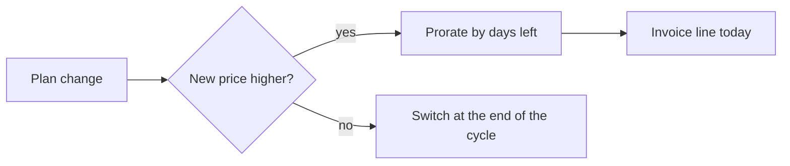

## Intent
> The problem in plain words, the ticket, what this change does not cover, and the decision the reader will be asked to make.

Customers who upgrade mid-month are charged the full new price today. Finance wants the charge prorated by remaining days, so an upgrade on day 20 of 30 costs one third of the difference.

**Out of scope:** downgrades (stay end-of-cycle), annual plans.

**You will be asked:** when the proration starts, and whether rounding once is fine for Finance.

## Design
> What changes, shown rather than told: a before/after example, a diagram, links to runs, demos or screenshots. One alternative you rejected and why. Merge requests go in Changes.

A new pure function, `prorate()`, is called by the plan-change handler only when the new price is higher.

**Before / after:** upgrade from 10 EUR to 40 EUR on day 20 of a 30-day cycle.

| | Invoice line today |
| --- | --- |
| Before | 30.00 EUR, the full difference |
| After | 10.00 EUR, the difference for the 10 days left |

A higher price is prorated by the days left; a lower one waits for the next cycle.

- Demo: [upgrade of test account #771 on staging](https://example.com/staging/plan-change)
- Golden data: [40 real customers against the Finance sheet](https://example.com/notebooks/proration-golden)
- Rejected: storing a proration row per change. The invoice line already carries the amount, a second table would drift.

## Edge cases
> One row per case a reviewer might worry about: how it is handled and which check proves it.

| Case | Handled | Verified by |
| --- | --- | --- |
| Change on the last day of the cycle | Charged 1/30, not zero | unit test |
| Change on the first day | Full difference, no proration | unit test |
| Leap year February | Uses real cycle length, 29 days | unit test |
| Two changes in one day | Second change prorates from the first | integration test |
| Currency rounding | Round half-even to cents, once, at the end | golden file |

## Verification
> Evidence, not claims: what each check proves, the command, the result (✅ passed, ⚠️ not run or partial, ❌ failed; give a reason for anything but ✅), a link to the run, and whether it fails if the change is reverted.

| Proves | Command | Result | Link | Fails on revert |
| --- | --- | --- | --- | --- |
| Proration math for all edge cases | `pytest tests/test_pricing.py` | ✅ 212 passed | [CI job #8812](https://example.com/ci/8812) | yes |
| Retried request does not prorate twice | `pytest tests/test_plan_change.py::test_retry` | ✅ passed | [CI job #8812](https://example.com/ci/8812) | yes |
| 40 real customers match the Finance sheet | notebook, run all cells | ✅ 40/40 match | [notebook](https://example.com/notebooks/proration-golden) | no, it reads past invoices |
| Upgrade works on staging | upgrade test account #771 in the UI | ✅ invoice line 13.33 EUR | [staging](https://example.com/staging/plan-change) | yes |
| No new errors after deploy | log query, last 2h | ⚠️ 40 minutes only, staging was redeployed | [log query](https://example.com/logs?q=plan-change) | no |

## Not verified / assumptions
> What you did not check and what you took on trust, so the reviewer can decide whether to trust it too.

- Annual plans were not tested. We assume they never reach the plan-change handler.
- Not run against production data volumes. The function is pure, so we expect no change in speed.
- Assumes the billing cycle dates in the database are always in the customer's local time zone.

## Rollback
> How to undo this change and what it leaves behind.

Revert the merge requests in Changes, newest first, and redeploy. No schema change and no data migration. Invoices already issued with a prorated line stay as they are.

## Security impact
> What the change touches that matters for security, or "None" with the reason.

None. The change only reads prices and dates that the handler already loads. It adds no input from users, no new endpoint and no new permission.

## Agent reviews
> Which reviewers ran and how often, with counts. The details stay in the merge requests; a dismissed finding a human must accept goes to Judge this.

| Round | Reviewers | Findings | Fixed | Dismissed |
| --- | --- | --- | --- | --- |
| 1 | quant, Python, security | 3 | 2 | 1 |
| 2 | quant, Python, security | 0 | 0 | 0 |

The dismissed finding is the second question in Judge this.

## Judge this
> The questions only a human can answer: product intent, trade-offs, risk you accept.

- Is "first day" the day the cycle starts, or the day after the previous invoice?
- Is rounding once at the end acceptable to Finance, or should each line round? (The quant reviewer flagged this; we kept one rounding.)

## Changes
> One row per merge request, in merge order, with its status. Put the ticket and dashboards in the report's links instead.

| # | Repo | Merge request | What it changes | Status |
| --- | --- | --- | --- | --- |
| 1 | billing-service | [!231](https://gitlab.example.com/billing/billing-service/-/merge_requests/231) | `prorate()` and the plan-change handler | open |
| 2 | invoice-ui | [!88](https://gitlab.example.com/billing/invoice-ui/-/merge_requests/88) | shows the prorated line on the invoice | open, merge after !231 |
