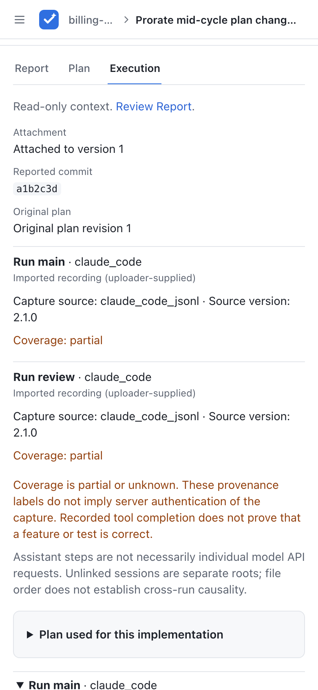

# Reviewing in the web UI

How people find work, sign versions and handle threads. For who may do what in shared mode, see [access.md](access.md).

## Personal views

The sidebar has four views under **Your work**:

- **Inbox** (`/`, the home page) shows what needs you, grouped by whose turn it is:
  - **Needs your review**: changes where your review was requested and the status is awaiting review: the author has signed this version and no reviewer has given a verdict on it yet. As soon as any reviewer gives a verdict, the change leaves this group for every requested reviewer. When a reviewer requests changes, the turn passes to the author (it shows in their **Returned to you**), and it comes back to you after the author pushes and signs a new version. High risk comes first, then the ones waiting longest. Your own changes, and changes you signed, never show here, even if you are on their reviewer list.
  - **Needs your signature**: your unsigned changes. In local mode it also shows unsigned changes with no owner, because anyone can sign those.
  - **Returned to you**: your changes where a reviewer requested changes.
  - **Needs implementation**: your plan-first reviews whose current plan is approved and have no implementation attached yet. Ask the agent to submit the report at the same ID.
  - **Waiting on others**: your signed changes that wait for a review. This group starts closed.

  When a new version is pushed, the change goes back to the author to sign, and then back to the reviewers. When nothing needs you, the Inbox says so. With no projects yet, it shows how to connect your first agent.
- **Assigned to me** (`/changes?scope=reviewer`) lists every review someone asked you to review, including finished ones. Here you are the reviewer.
- **Created by me** (`/changes?scope=author`) lists every review you own (your agents published it with your token), including unsigned drafts. Here you are the author and wait for others.
- **All reviews** (`/changes`) lists everyone's reviews. Everyone sees all projects and reviews.

The lists and project pages (`/p/<project>`, under **Projects** in the sidebar) have status tabs with counts. A report is at `/r/<id>`.

The **System / Light / Dark** switch at the bottom of the sidebar sets the theme for this browser (a cookie). **System** follows your operating system.

Below 1024px wide the sidebar becomes a menu that opens from the top bar. On the review page it is always a menu, so the report gets the full width.

Your id is at the bottom of the sidebar, with a button to copy it. Give it to your agent. Set `author_id` to the owner's id and `reviewers` to the requested reviewers' ids when publishing. In shared mode the agent token sets the owner, so `author_id` can be left out. Display names do not decide ownership. Review requests help people find work. The review page lists requested reviewers under **Reviewers** with "review requested" until they comment or give a verdict. Anyone with access can still read and review a report, and the normal signing and approval rules apply.

## Report and Plan

Direct artifact submissions open on **Report** at `/r/<id>`. When the selected version has an attached plan, use **Plan** (`/r/<id>?tab=plan`) to read it, then return to **Report** to sign, comment or give a verdict. In this workflow the plan is read-only context: it has no separate comments, signing controls or independent approval. A report verdict is not separate approval of the plan.

Version history shows the plan saved with each version, including at `/r/<id>/v/<n>?tab=plan`. Replacing or removing a plan leaves older snapshots intact. History links keep Plan selected when the destination has a plan; a version without one opens Report. Execution is available separately when evidence is attached, as described below. Report/Plan links work with Tab/Enter, browser Back and JavaScript disabled. Comment deep links open Report.

Attaching, replacing or removing a plan creates a new unsigned report version, even if the implementation body is unchanged. Sign that version on Report before anyone can give a verdict. Earlier signatures and verdicts remain in history and do not approve the new version. See [Optional plan](api.md#optional-plan) for submission.

## Plan-first reviews

For a plan that needs approval before work starts, the agent creates a review with `workflow: "plan_first"`, one nonblank Markdown `plan`, and no implementation body. Plans can use any headings or none. There is no browser editor or upload form; the agent submits and revises documents through the API. The report keeps the same ID and URL through both stages. A workflow cannot be changed after creation; existing artifact reviews keep their behavior.

1. Open the review. **Plan** is selected while the plan needs action. Sign the displayed plan revision, then have another person review it. Use text selection, a section comment, or the **General comments** form for a general concern. Signing rules are the same as for reports: owner only in shared mode, existing trusted cookie identities in local mode.
2. Reviewers approve the plan or request changes. Its signature and verdicts belong to the exact Markdown revision. Changed text needs a new signature and approval; unchanged text keeps its approval even when an implementation version is added. A revision number is the snapshot that introduced the text, so plan revision numbers can skip integers. Reverting to earlier text after an edit creates a new revision.
3. After effective plan approval, the status is **Awaiting implementation**. This is still open work. The agent attaches its normal report under the same ID with the latest `expected_version`. It may omit the plan to inherit it or repeat the exact approved text. It cannot change the plan and submit an implementation in the same push.
4. **Implementation** then becomes the default document. The owner signs its version and another person gives an implementation verdict. The plan's approval does not approve the implementation. Overall **Approved** requires an approved current plan and implementation.

Use the document links to switch at any point. `/r/<id>?tab=implementation` explicitly opens the implementation even while a plan needs action; before attachment it shows that implementation is pending. Plan and implementation comments and quote anchors stay separate. Requested reviewers stay on the review across both stages and can be asked to judge each document.

An unresolved blocking plan thread pauses implementation attachment, updates, signing and verdicts, including when it is reopened after approval or began on an older plan revision. Resolving it or making it non-blocking restores approval for unchanged plan text without changing verdict history. A reviewer can record **Request plan changes** to withdraw their approval. Suggestions do not pause the gate, and implementation threads do not block plan approval. Direct artifact reviews retain their existing reopening behavior.

Changing a plan after implementation exists preserves the body and its commit in a new snapshot. The plan must be approved again before implementation review can proceed, and that new snapshot needs a fresh implementation signature and verdict. Every body-containing snapshot has a separate implementation review, even when its body was inherited unchanged.

History pages show the exact stored Markdown and the signature and verdicts associated with that document revision. Earlier threads may appear as stale concerns; roots from later revisions are excluded. Threads show their live replies, resolution and blocking state, rather than a frozen view of feedback at snapshot creation. Prior and superseded verdicts remain available. **Current:** followed by a status, when shown, describes today's gate separately from historical content. Metadata such as title and links keeps its latest value; only document Markdown is versioned.

## Execution

When the selected snapshot has evidence, **Execution** appears beside **Report** (or **Implementation**) and **Plan** when present. Open `/r/<id>?tab=execution` or a historical `/r/<id>/v/<n>?tab=execution`. History keeps Execution selected even for versions without evidence. An explicit Execution URL without evidence says **No execution trace attached to this version** and links to the document; it never silently selects another tab. Reports without evidence otherwise keep their normal navigation and review behavior.

Execution is read-only context, with a link back to the implementation's review controls. It has no signing, verdict, reviewer-management or comment forms. Presence, failure or missing coverage in a trace never changes approval automatically. To raise a concern, return to the implementation; plan concerns still belong on Plan. The existing plan-first approval gate and reopened-blocker holds remain in force.

Start with the attachment version, reported commit, original plan revision when present, capture source and coverage warnings. A reported commit is the uploader's claim, not proof that those bytes ran. Each run is labelled **Imported recording (uploader-supplied)** or **Agent-written reconstruction**; neither label authenticates its source. A completed call does not prove correct behavior or a passing test. Assistant steps are not necessarily individual model API requests.

Expand the indented call tree to read kind, title, status and known timing. Details show any recorded plain-text input/output, explanation, exit code and source reference. Missing data says **Not recorded**, rather than implying zero duration or success. Parent links appear only when the source explicitly provides them; separate roots and file order do not establish cross-run causality. Stable event links reveal their ancestors when opened.

A diagram in a report is drawn from its Mermaid source. To comment on part of it, open the source with the **Show diagram source** button (the `<>` icon next to the diagram) and select the text there. Screenshots the agent uploaded show inline.

The report header shows the ticket and any merge or pull request from the report's links as a short label made from the URL, such as `billing-service!231`. Any other links the agent sent stay in the **Links** line at the bottom, with its labels. Reports in the current template list their merge requests in the **Changes** section. See [API](api.md) for the rules.




**Plan used for this implementation** shows the exact bound plan, not today's latest plan. On desktop it can sit beside the tree; on mobile it precedes it. A later revision is linked separately with an explanation that the evidence was attached against the older plan. A plan-only update can therefore show an older trace binding alongside a newer current plan. No plan is a valid state, and there is no automatic score claiming all plan steps were covered.

The tree expands with keyboard controls, visible focus and text status labels, and remains usable without JavaScript. It supports light/dark themes and 320px layouts; long output wraps or scrolls inside its panel. For local capture, submission and privacy limits, see [tracing.md](tracing.md). Evidence has the report's existing readers; removing it from a new version does not erase older evidence.

## Request a review

In shared mode, any member can ask someone to review a change. Under **Reviewers** on the review page, pick a member and press **Request**. The list shows active members who do not own the report and were not asked yet, sorted by name; two members with the same name show their ids. A requested reviewer who has no current verdict on either review target has a **Remove** button. A current plan verdict still protects the request after implementation attachment. Removing a request does not remove comments or verdicts. The person sees the change in their Inbox (**Needs your review**) once the author has signed the actionable document, and in **Assigned to me**. Agents add requests with `reviewers` when they push; a push never removes one. Requests are changed on the latest snapshot only.

In local mode there is no picker. Agents set `reviewers` when they push, and **Remove** works as in shared mode.

### Emails

With `VERIFAIR_SMTP_URL` and `VERIFAIR_EMAIL_FROM` set (see [configuration.md](configuration.md)), shared mode also sends a plain-text email:

- when the author signs a version: to every requested reviewer except the signer,
- when someone adds a reviewer while the current version is signed: to that person. Adding yourself sends nothing.

A push makes a new unsigned version, so it sends no email; the reviewers get one when the author signs it. Emails go only to active members whose id is one plain address, such as `bob@example.com`. Each running verifair instance sends a person at most one email per report version, so removing and adding them again sends nothing new; a restart or another replica may send it again. An email that failed to send does not count, so after the mail server is back, removing and adding the person sends it. Local mode sends no email.

For plan-first reviews emails identify **plan revision R** or **implementation vN**, and link to that document. Delivery is deduplicated separately for each target and revision. Signing an unchanged plan again after attachment sends no duplicate plan email. Adding someone while an approved plan awaits implementation keeps the review request without sending an implementation-ready email. Plans do not need a **Judge this** section; the excerpt is omitted when it is absent. Pushes send draft webhook messages, if configured, rather than ready-for-review email. Notification delivery failures do not undo saved review work.

The subject is `Review requested: "<title>"`. For plan-first reviews it ends with the document, for example `Review requested: "<title>" (plan revision 2)` or `Review requested: "<title>" (implementation v3)`. The text says who signed which version and who asked for the review, then the project, the risk, the report's **Judge this** section as plain text, labelled as written by the agent, (the report template's `> The questions only a human can answer…` line and code blocks left out, links as their text, up to about 1,500 characters, then "Read the rest on the page.") and the link:

```text
Alice signed v3 of "Prorate plan changes by day". You were asked to review it by Bob.

Project: billing · Risk: high

Judge this (written by the agent, not checked by verifair):
Is a day the right unit for proration?

Open it to comment, approve or request changes:
https://verifair.example.com/r/prorate

— Sent by verifair. Replies to this mail are not read.
```

Someone added after the version was signed gets `Bob asked you to review "<title>" (v3, signed by Alice).` as the first line.

Local identities belong to a browser. In shared mode, sign-in supplies the same id (your email) on every device. In local mode, signing a report without an owner records the signer as the owner, and **Created by me** also lists unowned reports whose `author` equals your identity. In shared mode only `author_id` counts, and a report without an owner is frozen (see [Report ownership](access.md#report-ownership)).

## Signing

- A version must be signed before anyone can approve or request changes on it. Until then the status is `unsigned`.
- The first signature on a version is kept. Signing again does nothing.
- In local mode, anyone who has set a name can sign. The name is only a cookie, so this is a convenience, not a control.
- In shared mode, only the owner can sign: `author_id` must equal the signed-in member's email. A report with no `author_id` cannot be signed: `This report has no owner. Push it again with an agent token under a new id.`
- The person who signed a version cannot approve it or request changes on it. Someone else has to.
- Only in shared mode, with sign-in, is signing a real control. See [access.md](access.md#set-up-shared-mode).

## Undo a signature or a verdict

- **Unsign:** the person who signed the current version, or an admin, can press **Unsign** next to "Signed by". It works only while nobody has approved or requested changes on that version; after that it stays signed, so the reviewers' verdicts keep their meaning. Ask them to withdraw their verdict first, or push a new version.
- **Unapprove** and **Withdraw request:** after you approve or request changes, that button turns into its undo. It removes your verdict on this version, and the status goes back as if you had not judged it. The other button stays, so you can also switch straight to the opposite verdict.
- In a plan-first review, the plan's approval and signature cannot be undone once the implementation is attached, because the implementation was reviewed against that plan. Push a new plan revision instead.
- Withdrawn verdicts are kept in the database for the record, but no longer count or show. Agents cannot sign, unsign or give verdicts, only people in the app.

## Blocking threads

- A new thread is blocking by default. A reviewer can tick "Non-blocking (suggestion)" when writing it, and switch a thread between blocking and non-blocking later. In shared mode only some people can do that; see [Moderation](access.md#moderation).
- Approve is refused while any blocking thread is open. Resolve the thread or mark it non-blocking first. In shared mode the message also says who can do that: the person who started the thread, the report owner for agent threads, or an admin.
- Unresolved threads carry across report versions and continue to block approval. `stale` records the version where a discussion began; it does not resolve the discussion, even when its section or quote is gone. Close obsolete concerns explicitly or mark them non-blocking.
- Request changes needs a summary, or an open blocking thread of your own.
- The sidebar counts open blocking threads and suggestions.
- In plan-first reviews blockers apply to their document, and plan blockers also pause the overall workflow as described above. The selected document's controls and the current status update after a thread is reopened, resolved or made non-blocking.

## Conventional Comments

The comment form has a row of label buttons: praise, nitpick, suggestion, issue, question, thought, todo, chore and note (see [conventionalcomments.org](https://conventionalcomments.org)). They need JavaScript.

- A button puts `label: ` at the start of the comment. Another button swaps the label. Clicking the pressed button removes it.
- `issue` and `todo` untick "Non-blocking (suggestion)", so the thread blocks. Every other label ticks it. You can still change the box by hand.
- The label is plain text in the comment (`issue: this breaks X`). Agents read it as text. You can also type it yourself, with decorations like `suggestion (non-blocking): ...`.
- A known label at the start of a comment is shown as a small badge. Other text before a colon stays plain.

## Archive and delete

**Archive** a review when it is done or was only a test. It leaves the Inbox, the change lists and the sidebar, but stays readable at its link, with a banner saying who archived it and when. Find archived reviews on the **Archived** tab of a list or project, and **Restore** them from the banner. The review's owner, the people asked to review it, and admins can archive and restore it, from **Manage** in the review's sidebar. Agents can do the same through the API ([api.md](api.md#archive-a-report)). People can still comment on, sign and judge an archived review from its page, but it takes no new versions until it is restored.

**Archive project**, at the top of a project page, archives every review in that project at once. Only admins see it.

**Delete permanently** removes a review with every version, comment, signature, verdict and review request. It cannot be undone. Only admins can do it, and they type the review id to confirm. A deleted id can be used again by a new push. In local mode, without sign-in, anyone can archive and delete.

Archive, restore, delete and project archive are logged as `access action=archive`, `restore`, `delete_report` and `archive_project`.
