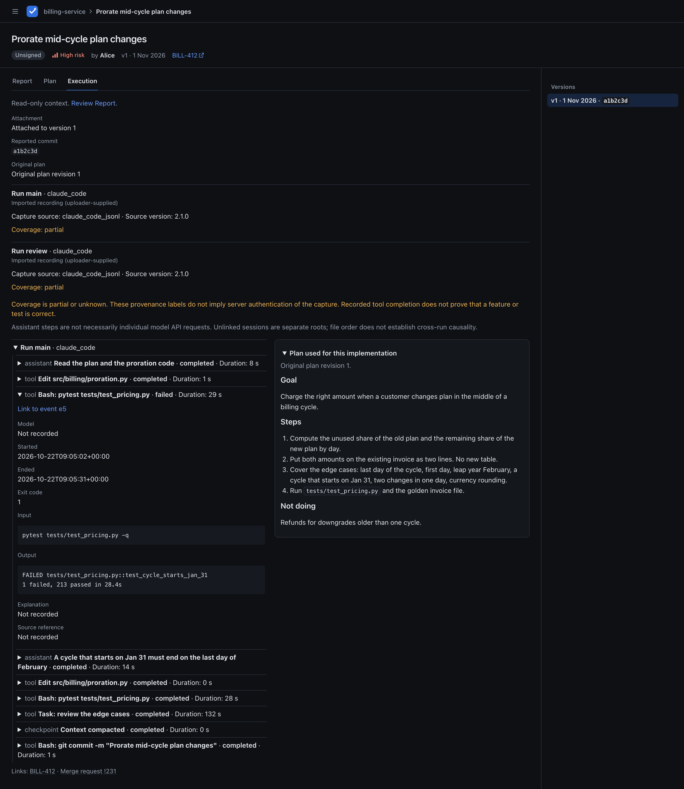

# Optional execution evidence

This page documents the intended implemented behavior of Phase 3, normalized schema v1. The capture recipes are pinned to the producer versions below; they are not observations from live model runs. Tracing is optional in both review workflows. Existing reports and submissions without traces keep working.

Execution evidence gives reviewers context about recorded work. **Imported recording (uploader-supplied)** and **Agent-written reconstruction** are different kinds of evidence. Neither label authenticates a capture. A completed tool call does not prove that a feature works or a test passed, and an assistant step is not necessarily one model API request.



Reviewers read it on the report's **Execution** tab; see [Execution](reviewing.md#execution).

## Convert a local capture

`python -m verifair.trace_import` ships with the existing package. It reads only files you explicitly name and writes normalized JSON. It never starts an agent, discovers sessions, reads your agent directories automatically, uploads anything or needs provider credentials.

```sh
python -m verifair.trace_import --format codex-exec-jsonl \
  --source-version 0.163.0 --input capture/events.jsonl --output trace.json
```

| Flag | Meaning |
| --- | --- |
| `--format` | One of the four format names below; native JSON is not accepted by the report API. |
| `--input PATH` | Explicit local input; repeat to combine captures, except Pi takes exactly one file. |
| `--output PATH` | New normalized JSON file; refuses to overwrite an existing path. Written atomically with mode `0600`. |
| `--source-version VERSION` | Actual producer version you recorded; the importer does not read a version file automatically. |
| `--include-details` | Include bounded, allowlisted text after best-effort credential removal. Inspect before sharing. |
| `--last-events N` | Keep the final N recognized events across the combined inputs, after merging updates; `1–1000`. Marks coverage partial and removes empty runs and unavailable parent references. |
| `--leaf ENTRY_ID` | Select ancestry in a branched Pi file; required when there is no unique leaf. |

Limits: 16 input files, 64 MiB combined raw input and 1 MiB per JSONL record. Archives and remote URLs are unsupported. Unknown format families, incompatible major/schema versions, no recognized events or unresolved required branch ancestry fail with a concise error. Missing or untested producer versions in a recognized family produce warnings. Unknown record kinds produce coverage warnings; unknown optional fields are ignored, not copied wholesale.

Missing completion records leave events running or unknown and mark coverage partial. Checkpoints and compaction remain visible; discarded history stays missing. Only documented source IDs deduplicate records. Repeated start/update/end records become one event. File order across runs is display order, not measured chronology or delegation.

## Supported capture formats

These are the initial compatibility baselines, checked from source/help on 2026-10-25. They do not promise compatibility with every release. Check the producer's current help and record the actual version when capturing.

The [synthetic fixture index](../tests/fixtures/traces/README.md) links each pinned capture and its provenance. Integration checks exercise all four converters through report submission and the Execution view in both workflows. These checks use synthetic records; no live model run or private transcript is a compatibility claim.

| Format | Pinned baseline | Scope and source |
| --- | --- | --- |
| `claude-stream-json` | Claude Code 2.1.309; documented SDK stream | Prospective native capture. Join tool-use/result IDs; a content-block stop is not tool completion. Child internals require actual child records. [CLI](https://code.claude.com/docs/en/cli-reference), [stream contract](https://code.claude.com/docs/en/agent-sdk/streaming-output). |
| `codex-exec-jsonl` | Codex 0.163.0 | Prospective `exec` capture; thread, turn and item lifecycle, with updates merged by scoped item ID. No universal timestamps or turn-start IDs; collaboration records need not contain child internals. [Usage](https://learn.chatgpt.com/docs/non-interactive-mode), [pinned emitter](https://github.com/openai/codex/blob/rust-v0.163.0/codex-rs/exec/src/exec_events.rs). |
| `opencode-v2-export` | OpenCode 2.1.3; source `bb25a2f4a3f3f04d7c344bec0c0574ea3510b3b1` | V2 `{info, messages}` projected history with tools in assistant `content[]`. V1 `{info, parts}` is unsupported. [Commands](https://opencode.ai/v2/docs/cli/commands/), [transfer schema](https://github.com/anomalyco/opencode/blob/bb25a2f4a3f3f04d7c344bec0c0574ea3510b3b1/packages/schema/src/session-transfer.ts), [message schema](https://github.com/anomalyco/opencode/blob/bb25a2f4a3f3f04d7c344bec0c0574ea3510b3b1/packages/schema/src/session-message.ts). |
| `pi-session-jsonl` | Pi 1.4.0; session header schema 3; source `4a080252f06caf63a525d7873c5d94d3c23887e0` | Selected ancestry from the entry graph; tool-call/result IDs are joined. Conversation ancestry is not execution nesting; message timestamps are not tool durations. No universal core subagent format. [Session format](https://github.com/earendil-works/pi/blob/4a080252f06caf63a525d7873c5d94d3c23887e0/packages/coding-agent/docs/session-format.md), [message contract](https://github.com/earendil-works/pi/blob/4a080252f06caf63a525d7873c5d94d3c23887e0/packages/coding-agent/docs/message-types.md). |

### Claude Code: capture new work

This starts an agent task. Use it only for work you have already authorized, in an explicitly selected project with `request.txt` containing that task. Use a fresh private capture directory. Keep stderr separate from JSONL.

```sh
umask 077
mkdir capture
claude --version > capture/producer-version.txt
claude -p --verbose --output-format stream-json \
  --include-partial-messages --forward-subagent-text \
  < request.txt > capture/events.jsonl 2> capture/stderr.log
python -m verifair.trace_import --format claude-stream-json \
  --source-version 2.1.309 --input capture/events.jsonl --output trace.json
```

Pass your recorded version if it differs. See [programmatic usage](https://code.claude.com/docs/en/headless). Preserve the agent process exit status separately if needed; it is not every tool's exit code.

### Codex: capture new work

Use a separate fresh directory, a selected project and an authorized `request.txt`:

```sh
umask 077
mkdir capture
codex --version > capture/producer-version.txt
codex exec --json - < request.txt > capture/events.jsonl 2> capture/stderr.log
python -m verifair.trace_import --format codex-exec-jsonl \
  --source-version 0.163.0 --input capture/events.jsonl --output trace.json
```

Pass the actual recorded version. See [non-interactive mode](https://learn.chatgpt.com/docs/non-interactive-mode). Keep process exit status separate from tool results.

Claude/Codex capture cannot be enabled retroactively. Arbitrary existing interactive histories are unsupported in this release; submit without a trace or use a labelled reconstruction. [Claude SDK history](https://code.claude.com/docs/en/agent-sdk/python#get_session_messages) and [Codex app-server history](https://learn.chatgpt.com/docs/app-server#read-a-stored-thread-without-resuming) are possible future readers, not current import formats. Private history formats have no first-release adapter or compatibility guarantee.

### OpenCode: export selected v2 work

```sh
umask 077
opencode --version > producer-version.txt
opencode session export ses_EXPLICIT_ID > session.json
python -m verifair.trace_import --format opencode-v2-export \
  --source-version 2.1.3 --input session.json --output trace.json
```

Substitute the selected session ID and actual producer version. Export selected children separately and add `--input child.json`. No child sessions are discovered automatically. A resumed child with several possible invocations keeps its known session parent but no guessed invocation edge; its history is not duplicated. V1's `opencode export` is a different format. Native `--sanitize` does not guarantee safe publication and may remove child links. See the [pinned exporter/sanitizer](https://github.com/anomalyco/opencode/blob/bb25a2f4a3f3f04d7c344bec0c0574ea3510b3b1/packages/core/src/session/transfer.ts).

### Pi: export the selected branch

While Pi is idle, `/session` identifies the selected session file. In its UI, use `/export /absolute/path/current-branch.jsonl` with the explicit `.jsonl` suffix. Then run:

```sh
python -m verifair.trace_import --format pi-session-jsonl \
  --source-version 1.4.0 --input current-branch.jsonl --output trace.json
```

Use your actual CLI version. A branch export can use its unique leaf. Alternatively, copy one selected full session file and supply `--leaf ENTRY_ID` if it has multiple leaves. Exactly one Pi input is allowed per conversion. The last appended branch is not assumed to be selected. Out-of-file references warn rather than trigger file reads; missing ancestry needed for branch selection is an error. JSONL export rewrites ancestry and gives its header a new timestamp, not the original execution start. `pi --export` produces HTML, not this JSONL. See the [branch exporter](https://github.com/earendil-works/pi/blob/4a080252f06caf63a525d7873c5d94d3c23887e0/packages/coding-agent/src/core/session-export.ts) and [interactive handler](https://github.com/earendil-works/pi/blob/4a080252f06caf63a525d7873c5d94d3c23887e0/packages/coding-agent/src/modes/interactive/interactive-mode.ts).

## Manual reconstruction

Use the same normalized schema with `origin: reconstructed`, `source_format: manual` and a nonblank `basis`. This is narrative context, not collected calls. Do not invent outputs, precise timing, models, exit codes, token usage or causal links from memory. A reconstructed tool's status stays `unknown`.

This valid synthetic example describes no actual execution. Save it as `trace.json` only to try the format:

```json
{
  "schema_version": 1,
  "runs": [{
    "id": "manual-1", "agent": "other", "origin": "reconstructed",
    "source_format": "manual", "coverage": "unknown", "warnings": [],
    "basis": "Synthetic example written by a person; no capture or actual tool results exist."
  }],
  "events": [{
    "id": "summary-1", "run_id": "manual-1", "ordinal": 1,
    "kind": "summary", "title": "Illustrative account", "status": "unknown",
    "explanation": "An account could describe the intended work here. Nothing in this example establishes that it ran."
  }]
}
```

## Normalized schema v1

The document has exactly `schema_version: 1`, `runs` and `events`. Unknown keys are rejected throughout. Text rejects NUL and lone surrogates; numbers must have the documented type and be finite. There are 1–16 runs, 1–1000 events, at least one event per run and at most 16 combined run/event nesting levels. References must exist, agree on their run and form no cycles.

| Run field | Contract |
| --- | --- |
| `id` | Unique document-local slug, 1–100 characters, `[A-Za-z0-9][A-Za-z0-9._-]*`. |
| `agent`, `origin` | `claude_code`, `codex`, `opencode`, `pi` or `other`; `recorded` or `reconstructed`. |
| `source_format`, `source_version` | Required nonblank format (max 80 characters); optional producer version (max 80). Omit unknown versions. |
| `coverage`, `warnings` | `partial` or `unknown`, never certified complete; up to 20 plain-text warnings of at most 500 characters. |
| `basis` | Optional provenance, max 2000 characters; required and nonblank for reconstruction. |
| `parent_run_id`, `parent_event_id` | Optional explicit parent run and event in that run. Parent event requires parent run. Unlinked runs are separate roots. |

| Event field | Contract |
| --- | --- |
| `id`, `run_id`, `ordinal` | Unique event slug with the run-ID bounds; existing run; positive integer unique in that run. Ordinals preserve source order, not cross-run time. |
| `parent_id` | Optional explicit parent event in the same run. |
| `kind`, `title` | `assistant`, `tool`, `checkpoint` or reconstruction-only `summary`; nonblank plain-text title, max 200 characters. Generated tool-name titles are labels, not observed prose. |
| `status` | `unknown`, `running`, `completed`, `failed` or `cancelled`. Recorded statuses need source support. Declined execution is cancelled, not evidence of a failed test. |
| `model` | Optional recorded identifier, max 100 characters. |
| `started_at`, `ended_at` | Optional timezone-bearing RFC3339 timestamps with at most six fractional-second digits, normalized to UTC; end cannot precede start. No required nesting across parent/child clocks. |
| `exit_code` | Optional signed integer, only on tools and only from structured source fields. |
| `input`, `output`, `explanation` | Optional plain text, max 16000 characters each; displayed as text, not executable HTML or Markdown. Explanation is exposed prose/summary or labelled reconstruction, never hidden thinking. |
| `source_ref`, `truncated` | Optional opaque ID, max 200 characters, not an automatic URL/path link; boolean defaults false, true when retained text was shortened. |

Reconstructed events cannot contain timestamps, model identifiers or exit codes as observed telemetry. Put uncertain recollections in explanation instead. Missing values stay absent/null. Duration exists only when both timestamps are known. Token/cost accounting is outside v1. Provider-exposed reasoning summaries can be labelled assistant events when details are explicitly included; compaction is a checkpoint, never a reconstruction-only `summary` event.

The normalized document is limited to **524288 bytes (512 KiB)** after validation and canonical UTF-8 JSON encoding: Unicode retained, sorted keys, compact separators and no NaN. The whole report request, including body, plan, trace and metadata, remains **1048576 bytes (1 MiB)**. A valid trace can still make a request too large (413). Events are never silently dropped to fit; select fewer with `--last-events` or reduce details. Truncation marks retained text but does not waive the byte limit.

## Inspect and submit

Raw prompts, assistant prose, arguments/results and rationale are excluded by default. Tool names, observed lifecycle states, known model names, checkpoints and explicit source relationships remain. `--include-details` permits only bounded, allowlisted text with best-effort removal of common credential keys and bearer values. Binary data, images, environment dumps, unknown objects and hidden/encrypted thinking are never copied.

**Inspect the local normalized JSON before submitting.** Redaction is incomplete: names, timestamps and ordinary prose may disclose sensitive information too. Capture files stay local; the server stores only normalized evidence, visible to the same readers as the report with no separate trace access list. Removing it from a new version leaves earlier versions intact. Accidental disclosure needs the instance operator's existing data-removal process, not a new erasure API.

After inspection, the [example request builder](examples/trace-report.py) reads only explicitly named local files and writes the JSON request to stdout. Run it with a private output file:

```sh
umask 077
python docs/examples/trace-report.py --project my-project \
  --title "Describe the change" --risk low --body "$REPORT_MD" \
  --trace "$TRACE_JSON" > request.json
```

Add `--plan PATH` for a plan, and `--id SLUG --expected-version N` for a guarded update. A supplied ID alone can still identify a new report. Omitting `--trace` from an implementation body update clears trace evidence for that new snapshot; plan-only updates preserve the existing trace. Review `request.json` before sending it. Then configure `VERIFAIR_URL` and `VERIFAIR_API_TOKEN` privately and send the file with curl, without shell tracing:

```sh
curl -sS --fail-with-body -X POST "$VERIFAIR_URL/api/reports" \
  -H "Authorization: Bearer $VERIFAIR_API_TOKEN" \
  -H "Content-Type: application/json" --data-binary @request.json
```

Use a report body with the instance's required headings. For updates, reuse the report ID, read the latest metadata and add `expected_version` with that `current_version` as an integer (for example, jq's `--argjson expected_version "$EXPECTED_VERSION"` and `expected_version: $expected_version` in the object). Every update carrying a trace object needs this guard, including artifact updates. A new report must omit it. Plan-first implementation also needs the current plan's effective approval; tracing never bypasses that gate. See the [API write table](api.md#optional-execution-evidence) for omission, null and preservation rules, and [Execution](reviewing.md#execution) for reading evidence.
